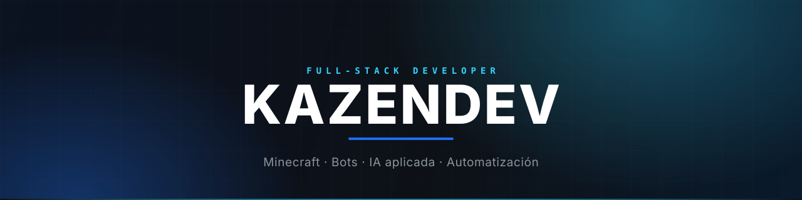
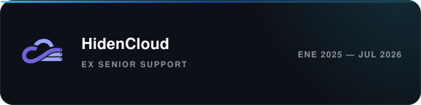
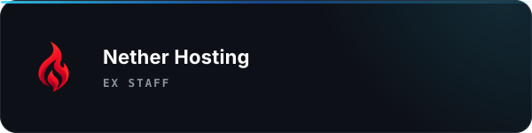
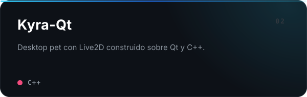
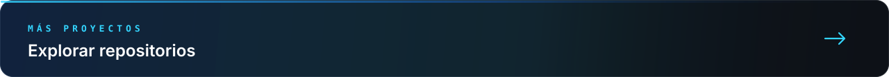
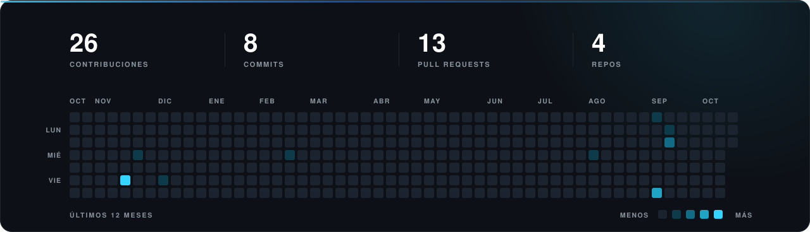
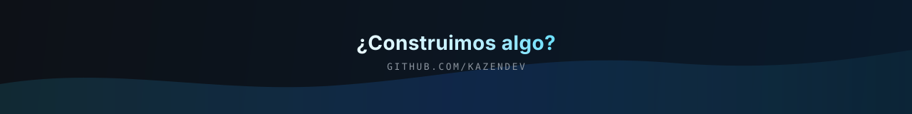

  

<h3 align="center">SOBRE MÍ</h3>

Desarrollador full-stack. Diseño y construyo producto propio: backends, bots e IA aplicada.
Trabajo sobre todo en TypeScript, Java y C++, y llevo años dentro del ecosistema de Minecraft
— plugins, proxies y servidores.

<h3 align="center">TRAYECTORIA</h3>

  
  

<h3 align="center">STACK</h3>

  

  

<h3 align="center">PROYECTOS</h3>

  
  

  

<h3 align="center">ACTIVIDAD</h3>

  

<h3 align="center">CONTACTO</h3>

  
  
  
  

  Disponible para colaboraciones, plugins a medida y desarrollo freelance.

