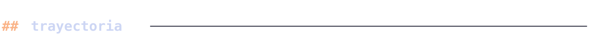

  <a href="https://vampsclub.shop">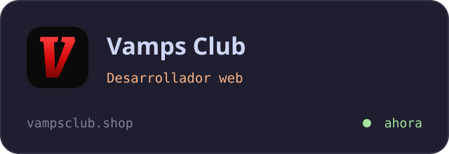</a>
  <a href="https://aiskaron.com">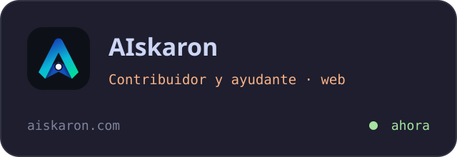</a>

  <a href="https://www.hidencloud.com">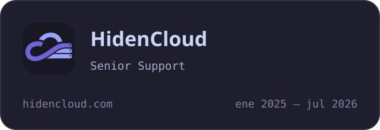</a>
  <a href="https://netherhost.cc">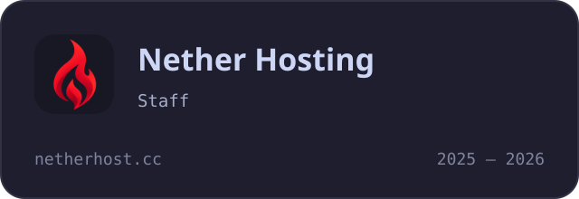</a>

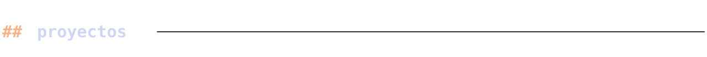

<a href="https://github.com/KazenDev/Kira">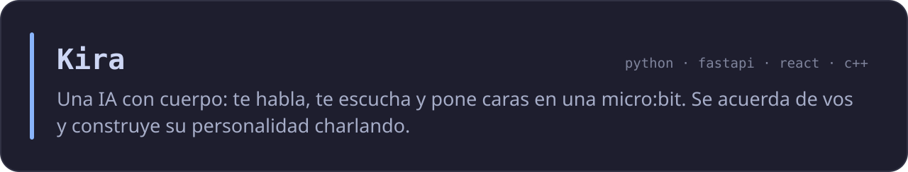</a>

<a href="https://github.com/KazenDev/JDevTools">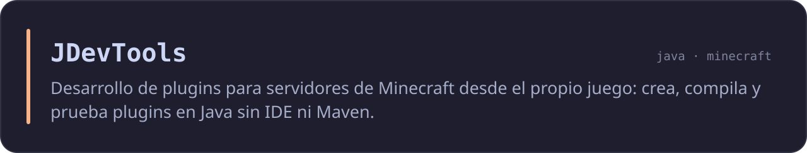</a>

<a href="https://github.com/KazenDev/Kyra-Qt">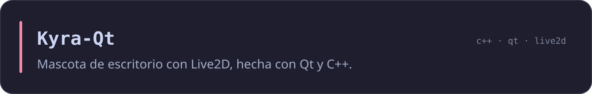</a>

<a href="https://github.com/KazenDev?tab=repositories">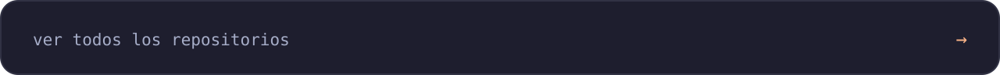</a>

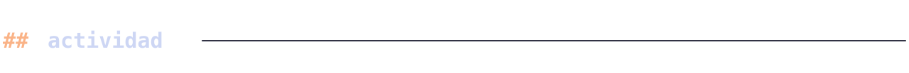

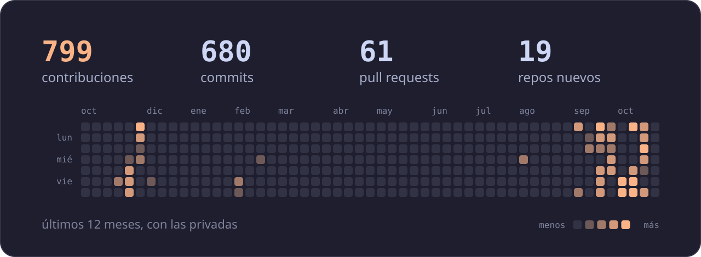

<a href="https://github.com/KazenDev">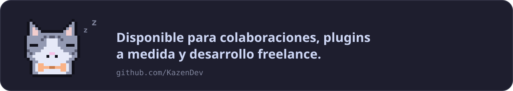</a>
